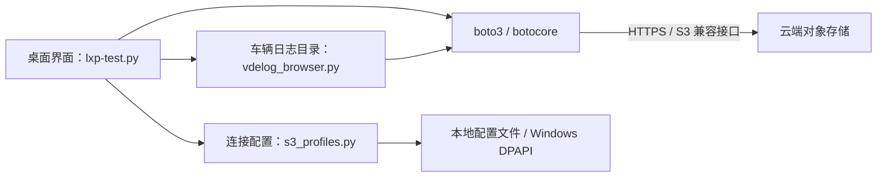

# OSS Browser

面向 Windows 的 S3 兼容对象存储桌面浏览器，使用 Python、Tkinter 和 boto3 实现。

## 功能

- 支持华为云 OBS、阿里云 OSS、腾讯云 COS、AWS S3 和自定义 S3 兼容服务。
- 保存多套连接配置，使用 Windows DPAPI 加密本地访问凭据。
- 浏览对象与目录，搜索、筛选和下载文件。
- 根据 Bucket 的区域信息及服务端响应修正连接 Endpoint。
- 在华为云车辆日志目录中，选择完整列表或按 VIN 查询单个车辆目录。

## 模块与数据流

本项目运行在用户电脑上，通过对象存储接口访问云端数据。车辆日志由外部系统采集并上传。



连接测试、目录分页、请求失败和并发刷新逻辑由 `tests/` 中的测试覆盖。

## 本地运行

需要 Windows、Python 3.11 或以上版本，以及 Tkinter。Windows 官方 Python 安装包通常包含 Tkinter。

在 PowerShell 中执行：

```powershell
git clone https://github.com/liwanspecial/oss-browser-public.git
cd oss-browser-public
python -m venv .venv
.\.venv\Scripts\python.exe -m pip install -r requirements.txt
.\.venv\Scripts\python.exe lxp-test.py
```

在界面中添加连接，填写自己的服务提供商、AK/SK 和 Bucket。华为云 OBS 可自动查询 Bucket 区域；自定义 S3 服务可填写 Endpoint 和寻址方式。

连接配置默认保存在 `%APPDATA%\LxpS3Browser\profiles.json`。其中的凭据绑定当前 Windows 用户加密，不应将本地配置文件提交到仓库。

## 车辆日志 Bucket

车辆日志范围选择适用于华为云 OBS 中配置的 Bucket，目录前缀为 `data/vdelog/`。默认 Bucket 使用示例名称 `example-vehicle-logs`。

使用自己的 Bucket 时，在启动程序前设置环境变量：

```powershell
$env:OSS_BROWSER_VEHICLE_LOG_BUCKET = "example-vehicle-logs"
.\.venv\Scripts\python.exe lxp-test.py
```

将示例名称替换为自己的 Bucket 名称。VIN 在界面中输入，源码与测试只保留虚构示例。

## 测试

```powershell
.\.venv\Scripts\python.exe -m pip install -r requirements-dev.txt
.\.venv\Scripts\python.exe -m pytest -q
```

部分测试创建并隐藏 Tkinter 窗口，需要能够运行 Windows 桌面程序。测试使用模拟对象存储客户端，无需提供云账号凭据。

## 许可证

本项目采用 [MIT License](LICENSE)。第三方依赖分别遵循各自的许可证。
